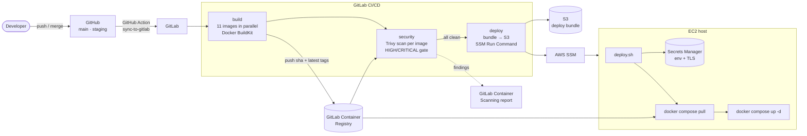

# GitLab CI/CD Secure Container Pipeline


This is the build, scan and deploy pipeline for Andishi, a multi-service SaaS platform that builds and hosts websites for small businesses. It builds 11 container images in parallel and scans each one with Trivy, and it blocks the release if any HIGH or CRITICAL vulnerability has a fix available. Deploys reach AWS EC2 through SSM Run Command, so the pipeline needs no SSH keys or open SSH port, and no secrets are baked into images.

> My role: I designed and built the pipeline end to end: the GitLab CI config, the vulnerability gate, the GitHub-to-GitLab sync, the SSM deploy and the on-host deploy script.

## Highlights

| | |
|---|---|
| Shift-left security gate | Every image is scanned with Trivy before it can deploy. A HIGH or CRITICAL finding with a fix available fails the job, and `needs:` stops the deploy. |
| Parallel matrix builds | One template builds all 11 services (Go APIs, React frontends, an AI service) through `parallel: matrix`. |
| Security reports in GitLab | Trivy results are exported in GitLab's Container Scanning format, so findings show up in GitLab's security UI and are kept as artifacts. |
| Keyless deploys | Deploys run through AWS Systems Manager Run Command. CI never opens an SSH session to the server. |
| Runtime secrets | App secrets and TLS certificates are pulled from AWS Secrets Manager on the host at deploy time. They are never stored in the repo or in images. |
| Traceable images | Every image gets two tags: an immutable `<env>-<commit-sha>` tag and a moving `<env>-latest` tag. |
| Separate environments | Pushes to `staging` deploy to the staging environment and pushes to `main` deploy to production. Each has its own images, bucket, instance and secrets. |
| Hybrid GitHub and GitLab | Code lives on GitHub. A GitHub Action mirrors `main` and `staging` to GitLab, and GitLab CI runs the pipeline. |

## Architecture



## Pipeline stages

### 1. Build

One hidden template (`.build-images-template`) defines a matrix of 11 services, and each runs as its own parallel job on Docker-in-Docker with BuildKit enabled:

`platform` · `cms` · `commerce` · `payments` · `booking` · `notifications` · `analytics` · `ai-server` · `admin` · `studio` · `preview`

```yaml
.build-images-template:
  stage: build
  image: docker:24-cli
  services: [docker:24-dind]
  parallel:
    matrix:
      - SERVICE: platform
        DOCKERFILE: platform/Dockerfile
      - SERVICE: payments
        DOCKERFILE: payments/Dockerfile
      # ... 11 services in total
```

Each image is built with its version stamped in (`--build-arg VERSION=<env>-<sha>`) and pushed to the GitLab Container Registry with two tags:

- `<service>:<env>-<commit-sha>` is immutable and lets you trace an image back to its commit.
- `<service>:<env>-latest` is the tag the environment's compose file runs.

### 2. Security (Trivy)

Each image has its own scan job. `needs:` links each scan to its build matrix, so a scan starts as soon as its builds finish without waiting for the rest of the stage.

```yaml
.trivy-scan-template:
  stage: security
  image:
    name: aquasec/trivy:latest
    entrypoint: [""]
  variables:
    TRIVY_SEVERITY: "HIGH,CRITICAL"
    TRIVY_EXTRA_ARGS: "--ignore-unfixed"
  cache:
    key: trivy-cache
    paths: [.trivycache/]
  script:
    # 1. Report: GitLab Container Scanning format (falls back to raw JSON)
    - trivy image --format template --template "@/contrib/gitlab.tpl"
        --output "gl-container-scanning-report-$SERVICE.json" "$IMAGE"
      || trivy image --format json --output "gl-container-scanning-report-$SERVICE.json" "$IMAGE"
    # 2. Gate: fail the job on any fixable HIGH/CRITICAL vulnerability
    - trivy image --severity "$TRIVY_SEVERITY" $TRIVY_EXTRA_ARGS --exit-code 1 "$IMAGE"
  artifacts:
    reports:
      container_scanning: "gl-container-scanning-report-$SERVICE.json"
    when: always
    expire_in: 7 days
```

How the scan stage is built:

- Report and gate are separate steps. The first `trivy` call always writes the full report and the second one decides pass or fail, so you get findings even from a run that fails (`artifacts: when: always`).
- The gate only fails on vulnerabilities you can fix. `--ignore-unfixed` skips CVEs that have no upstream patch yet. Every failure can be resolved by bumping a base image or dependency, so the team doesn't learn to ignore the gate.
- Accepted risks are recorded. A [`.trivyignore`](https://aquasecurity.github.io/trivy/latest/docs/configuration/filtering/#trivyignore) file at the repo root holds each CVE that was reviewed and accepted, with the reason, and changes to it go through code review.
- The scanner logs in to the registry with CI-scoped credentials. It reads private images using GitLab's short-lived `CI_REGISTRY_*` job credentials.
- The vulnerability DB is cached. `.trivycache/` is shared between jobs, so scans don't download the Trivy DB again on each run.

### 3. Deploy

The deploy job `needs:` the scan job for its environment, so if any of the 11 scans fails, nothing deploys.

```text
package bundle ──► upload to S3 ──► aws ssm send-command ──► poll status ──► print host logs
(compose file,                      (AWS-RunShellScript      (every 5s until   (stdout; stderr
 infra config,                       on the target EC2)       not Pending /     too on failure,
 deploy.sh)                                                   InProgress)       then exit 1)
```

1. The CI job tars up only what the host needs (the environment's compose file, infra config and `deploy.sh`) and uploads the tarball to S3.
2. The job runs `aws ssm send-command` with the `AWS-RunShellScript` document. The EC2 instance's own IAM role lets it fetch the bundle from S3.
3. The job polls `get-command-invocation` until the command finishes, then prints the host's stdout into the GitLab job log. If the deploy failed, it also prints stderr and fails the job. The CI log shows what happened on the server, so you don't need to SSH in to debug.

### 4. On-host deploy (`deploy.sh`)

Running `deploy.sh` on its own deploys staging, and `deploy.sh prod` deploys production:

| Step | What it does |
|---|---|
| 1 | Pulls the TLS certificate bundle from Secrets Manager (stored as a binary secret) and unpacks it |
| 2 | Pulls the environment's `.env` from Secrets Manager. If that fails, it keeps the last good file instead of deploying with an empty config |
| 3 | Logs Docker in to the GitLab registry |
| 4 | Runs `docker compose pull` to fetch the newly scanned images |
| 5 | Runs `docker compose up -d --remove-orphans`. If that fails, it dumps the message broker (NATS) logs and exits non-zero |
| 6 | Prunes dangling images so the host's disk doesn't fill up |
| 7 | Prints `docker compose ps` as a health snapshot in the CI log |

## Branching and promotion

| Branch | Images tagged | Scan job | Deploy target |
|---|---|---|---|
| `staging` | `staging-<sha>`, `staging-latest` | `trivy-scan-staging` | Staging EC2 |
| `main` | `prod-<sha>`, `prod-latest` | `trivy-scan-prod` | Production EC2 |

Every job uses `rules:` on `$CI_COMMIT_BRANCH`. Staging and production use the same templates, so the two environments can't drift apart in how they build or scan.

## GitHub to GitLab sync

The source repo is on GitHub and the pipeline runs on GitLab. A small GitHub Actions workflow links the two:

```yaml
on:
  push:
    branches: [main, staging]
permissions:
  contents: read
jobs:
  sync-to-gitlab:
    steps:
      - uses: actions/checkout@v4
        with: { fetch-depth: 0 }
      - run: git push gitlab "${{ github.ref_name }}"   # token from GITLAB_SYNC_TOKEN secret
```

- The workflow can only read the repo (`permissions: contents: read`). It pushes to GitLab with a token that only has `write_repository` scope.
- If the secret is missing, the job fails and explains how to set it up.

## Security controls

| Threat | Control |
|---|---|
| Shipping images with known, fixable CVEs | Trivy gate on HIGH and CRITICAL findings, enforced with `needs:` |
| Secrets leaking through the repo or images | Secrets live in AWS Secrets Manager and are pulled at runtime on the host |
| Long-lived server access keys in CI | No SSH. Deploys run through AWS SSM Run Command |
| Silent risk acceptance | `.trivyignore` changes go through code review with a written reason |
| Not knowing what is running where | Images tagged with the commit SHA and version stamped at build time |
| Failed deploys with no context | Host stdout and stderr streamed into the GitLab job log |
| Over-privileged CI integrations | Read-only GitHub token scope and a GitLab token limited to `write_repository` |

## Tech stack

- CI/CD: GitLab CI/CD, GitHub Actions, Docker-in-Docker, BuildKit
- Security: Trivy, GitLab Container Scanning reports
- Cloud: AWS EC2, Systems Manager (SSM), S3, Secrets Manager, IAM instance roles
- Runtime: Docker Compose, NATS
- Services: Go microservices, React/Vite frontends, an AI service

## Repository layout (pipeline-related files)

```text
.
├── .gitlab-ci.yml                  # build → security → deploy pipeline
├── .trivyignore                    # reviewed and accepted CVE exceptions
├── deploy.sh                       # on-host deploy script (run through SSM)
├── docker-compose.staging.yml      # staging runtime definition
├── docker-compose.prod.yml         # production runtime definition
└── .github/workflows/
    └── sync-to-gitlab.yml          # GitHub → GitLab mirror trigger
```
